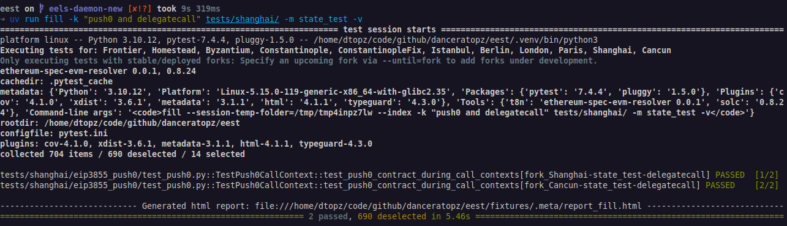

# Filling Tests for Features under Development

## Requirements

By default, the execution-testing framework only generates fixtures for forks that have been deployed to mainnet. In order to generate fixtures for evm features that are actively under development:

1. A version of the `evm` and `solc` tools that implement the feature must be available (although, typically only a developer version of the `evm` tool is required, usually the latest stable release of `solc` is adequate), and,
2. The development fork to test must be explicitly specified on the command-line:

    === "via the `--fork` flag"

          ```console
          uv run fill -k 4844 --fork=Cancun -v
          ```

    === "via the `--from` flag"

          ```console
          uv run fill -k 4844 --from=Cancun -v
          ```

    === "via the `--until` flag"

          ```console
          uv run fill -k 4844 --until=Cancun -v
          ```

!!! note "Specifying the `evm` binary via `evm-bin`"
     It is possible to explicitly specify the `evm` binary used to generate fixtures via the `--evm-bin` flag, for example,

     ```console
     uv run fill --fork=Cancun --evm-bin=/opt/bin/evm -v
     ```

## Synthetic blob schedules

Every fork from Amsterdam on gets two blob parameter only (BPO) scenario forks, generated in `forks.py`, so a new fork or a new BPO fork needs no extra work:

- `<Fork>BPOIncrease` raises the target of `<Fork>` by half.
- `<Fork>BPODecrease` lowers the target of `<Fork>` to two thirds.

Both keep the max to target ratio of `<Fork>`, rounded up, and scale the update fraction with the target, as on mainnet, so the blob base fee falls at the same rate per empty block. They run under the rules of `<Fork>`. For Amsterdam the increase is 21/32 with update fraction 17527006 and the decrease is 9/14 with update fraction 7511574. These are test scenarios, not scheduled network upgrades.

Both scenarios follow `<Fork>` directly and take the next client BPO slot after the BPO forks it descends from, so the Amsterdam scenarios both fill `HIVE_BPO3_*`. The transitions into them activate at timestamp 15,000 and leave out the repeated fork name, for example `AmsterdamToBPOIncreaseAtTime15k` and `AmsterdamToBPODecreaseAtTime15k`. Hive already maps the numbered keys onto the client config, so a new fork or BPO fork needs no Hive change either.

A fork range fills the scenarios of every fork it selects, together with the transitions into them, so releases, devnets and CI include them with no extra option. For example, `--until=Amsterdam` fills `AmsterdamBPOIncrease`, `AmsterdamBPODecrease` and both transitions. `--fork=Amsterdam` fills Amsterdam alone; select a scenario on its own with `--fork=AmsterdamBPODecrease`.

```console
uv run fill tests/osaka/eip7918_blob_reserve_price/ --from=Amsterdam --until=Amsterdam
```

`--until=Amsterdam` still excludes the historical parallel BPO3–BPO5 branch. Numbered fork and transition definitions remain available for older fixtures and genesis files.

Clients must permit their BPO slots to activate after the fork the scenarios follow. Successful filling does not establish client compatibility.

On BPO forks, including these scenarios, only the tests marked with `valid_for_bpo_forks` run. Mark tests whose case count stays small, since every scenario multiplies it.

## Further Help

1. [`geth`/`evm` build documentation](https://geth.ethereum.org/docs/getting-started/installing-geth#build-from-source).
2. [`solc` build documentation](https://docs.soliditylang.org/en/v0.8.20/installing-solidity.html#building-from-source).

!!! note "Verifying `evm` and `solc` versions used"
     The versions used to generate fixtures are displayed in the console output:
     <figure markdown>  <!-- markdownlint-disable MD033 (MD033=no-inline-html) -->
          {align=center}
     </figure>
